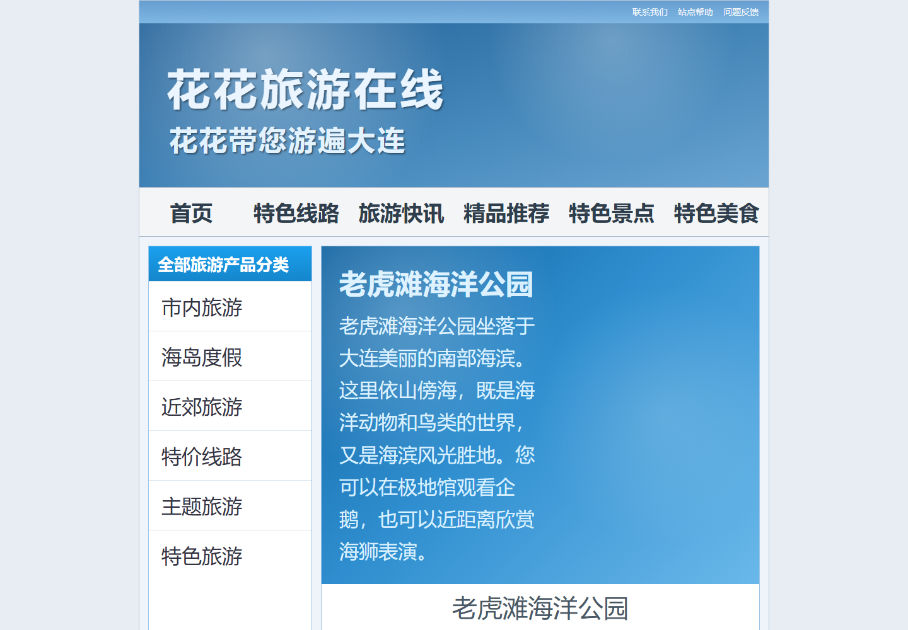
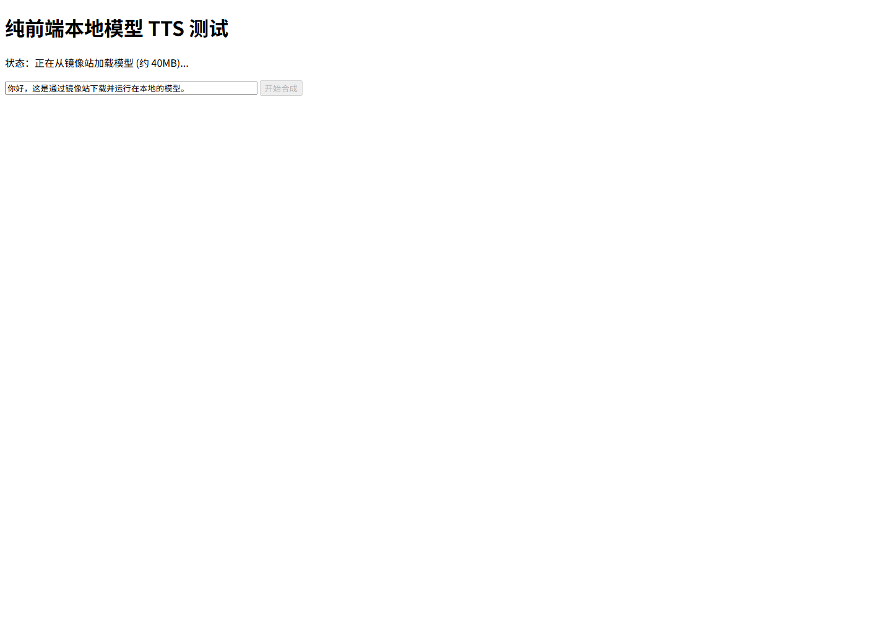

# Web Experiments · 前端实验合集

> 前端课程实验与 WebRTC/本地 AI 小实验合集：HTML/CSS 页面布局、JavaScript 购物车、WebRTC 信令、本地 TTS 前端演示。
> 作者/整理：**hhxpoint**；部分实验基于课程要求或第三方库，来源在子目录 README 中注明。


---

## 子项目

| 目录 | 内容 | 运行 |
|---|---|---|
| `web-layout/` | 旅游首页布局、宠物商城购物车（HTML/CSS/JS） | 直接打开 HTML |
| `webrtc-signaling/` | WebRTC 信令服务器 + 管理员/播放页 | `npm install && npm start` |
| `onnx-tts-demo/` | 浏览器本地 TTS（Transformers.js + MMS 模型） | 直接打开 HTML（需联网加载模型） |

---

## 界面

### 旅游首页布局



### 购物车实验


### 本地 TTS



---

## 1. web-layout

- `a.html` / `a.css`：旅游网站首页布局
- `b.html` / `b.css` / `b.js`：宠物商城购物车，支持修改数量、删除、清空、合计
- 直接用浏览器打开 `a.html` 或 `b.html`

## 2. webrtc-signaling

```bash
cd webrtc-signaling
npm install
npm start
# http://localhost:3000 播放页
# http://localhost:3000/admin 管理页
```

> 信令服务基于 Express + Socket.IO；实际音视频连接需要两个浏览器页面。

## 3. onnx-tts-demo

- 使用 `@xenova/transformers`（Transformers.js）在浏览器本地运行 `Xenova/mms-tts-zho` TTS 模型
- 模型通过 `hf-mirror.com` 镜像加载
- 直接打开 `index.html`，首次加载约 40MB

> 本实验依赖 Transformers.js / Hugging Face 模型，遵循其各自许可证；页面代码为演示封装。

---

## 测试与验收

```bash
node --check webrtc-signaling/server.js
node --check webrtc-signaling/public/*.html 2>/dev/null || true
```

手工验收：

- [ ] `a.html` 布局正常
- [ ] `b.html` 购物车增减/删除/清空/合计正确
- [ ] 信令服务启动，两个页面可加入房间
- [ ] `onnx/index.html` 能加载模型并合成语音

---

## 来源与贡献

- `web-layout`：课程前端实验，页面与样式由 hhxpoint 整理。
- `webrtc-signaling`：基于 Socket.IO/WebRTC 的信令示例，由 hhxpoint 整理。
- `onnx-tts-demo`：基于 Transformers.js、Hugging Face 模型；原始库与模型版权归各自作者。

如原课程/团队对某部分有署名要求，请保留对应说明；本仓库不主张第三方库/模型的版权。

---

## License

本仓库代码 MIT；第三方库与模型遵循各自许可。
